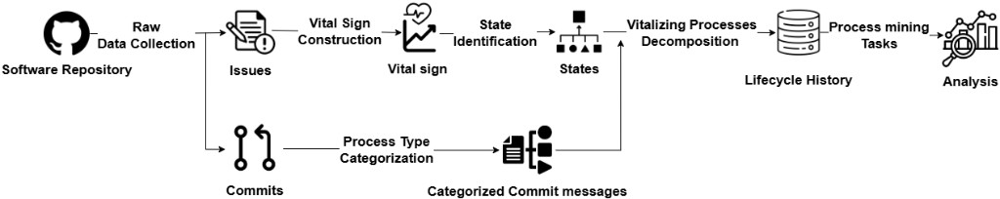

# Lifecycles-Processes

Modeling and Analyzing Software Development as a Lifecycle Process.



## What is the layout of the repo

```text
Lifecycles-Processes/
├── commitizen.ipynb                 # main study; run top to bottom
├── evaluation-ablation study.ipynb  # compare partitions across six repositories
├── functions/                       # analysis modules and per-repo configs
├── data/                            # extraction notebook, raw databases, token file
│   ├── data extraction.ipynb
│   ├── raw/                         # DuckDB and OCEL2 SQLite files
│   ├── event logs/                  # zipped XES logs for the six repositories
│   └── README.md                    # how to extract raw data
├── results/
│   ├── tables/                      # CSV and Excel outputs
│   ├── figures/                     # figures (PNG and PDF)
│   └── figures_no_titles/           # the same figures without titles
├── replication/                     # same pipeline for yargs, semantic-release, TradingAgents, Vibe-Trading, and Qlib
├── docs/                            # pipeline figure, motivation notes
└── requirements.txt
```

## How to extract data? (If you want to replicate from scratch with your own target repository)

1. Install dependencies: `pip install -r requirements.txt`.
   (ATTENTION: Do not trust me and always read what you are installing.)
2. Create a gitignored GitHub token file at `data/configToken.py`.
   (ATTENTION: Do not commit your personal token in public.)
3. Run `data/data extraction.ipynb` from `data/`.

Details: [data/README.md](data/README.md). Thanks to Lien Bosmans for [pystackt](https://github.com/LienBosmans/pystackt).

## How to run `commitizen.ipynb`?

1. Install dependencies (Python 3.10+): `pip install -r requirements.txt`.
2. Put `commitizen.duckdb` and `ocel2_commitizen.sqlite` in `data/raw/` (extract them first if they are not there yet).
3. Run `commitizen.ipynb` from the repository root.

Outputs go to `results/`. Petri-net cells need Graphviz on `PATH`.

## What are the analyses in `commitizen.ipynb`?

1. Load issues and weekly counts
2. Rolling IQR anomaly detection
3. Export anomaly IDs
4. Anomaly figures
5. Commit classification (Regex method)
6. Flatten the OCEL2 issue log
7. Partition the log and score discovery F1 (categories, anomaly/normal, anomaly x category, random, clustering)
8. Petri nets by commit category
9. Petri nets by anomaly, normal, and whole
10. EPA complexity for each partition

## What are the analyses in the ablation study?

[`evaluation-ablation study.ipynb`](evaluation-ablation%20study.ipynb):

- Goal: test whether partitioning the log by state and category beats other alternatives as baselines.
- Ours: States, Categories, States x Categories.
- Baselines: None, Random (10 buckets, 10 seeds), Clustering (kmean with 5 clusters).
- Repositories: commitizen, yargs, semantic-release, TradingAgents, Vibe-Trading, Qlib.
- Metrics: cycle time, F-score, log complexity (entorpy).
- Run the repo notebooks first; outputs go to `results/tables/compare/`.
